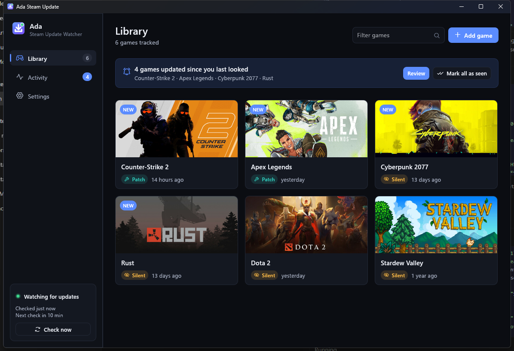
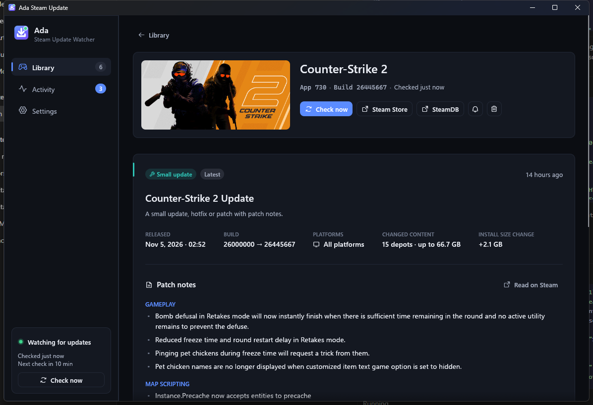
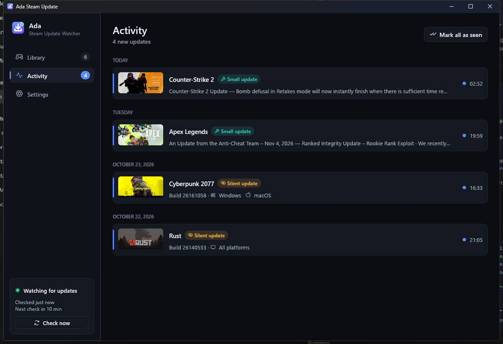
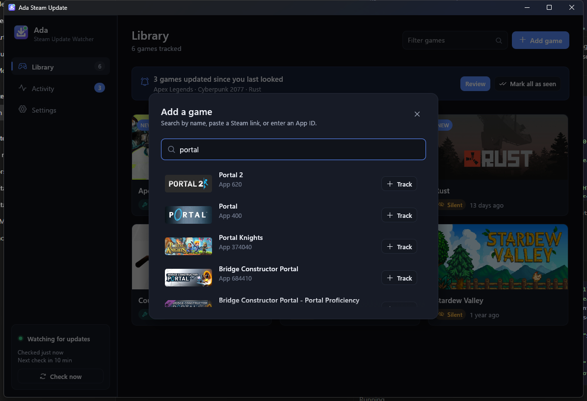

# Ada — Steam Update Watcher

Get notified the moment a Steam game you follow ships an update, and see exactly **what kind of update** it was.

Ada is a small, fast, native desktop app written in Rust. It runs on Windows, macOS and Linux, needs no Steam account or API key, and keeps everything on your machine.



## Features

- **Instant update detection.** Ada watches each game's public Steam build. Silent updates that ship without an announcement are caught too.
- **Catches up after being closed.** When Ada starts, it checks every game straight away, and the first screen lists the games that updated while it wasn't running.
- **Knows what kind of update it was:**
  - **Major / Regular / Small update**: the developer's own classification from Steam.
  - **Silent update**: a new build with no announcement. If patch notes are published later, Ada attaches them automatically for up to a week.
  - Affected **platforms** (Windows / macOS / Linux), number of **changed depots**, **download size** and **install-size change**.
  - The full **patch notes**, rendered natively, with a link to the announcement on Steam.
- **Desktop notifications** with a per-game mute.
- **Lives in the system tray** (Windows & macOS). Closing the window keeps Ada watching, and a red dot on the tray icon means there are unseen updates.
- **Launch at startup** (optional). It can start quietly in the background.
- **Add games your way**: search by name, paste a Steam store or SteamDB link, or type an App ID.
- **Activity feed** of every detected update, grouped by day.
- Dark and light themes that follow your system. Native fonts, keyboard shortcuts, no idle CPU use.

| Update details | Activity | Add a game |
| --- | --- | --- |
|  |  |  |

## Install

Download the latest build from the [Releases page](https://github.com/NeXuS4Dev/ada-steam-update/releases/latest):

| Platform | File |
| --- | --- |
| Windows 10/11 (x64) | `ada-steam-update-windows-x64.exe`: run it directly, no installer needed |
| macOS (Apple Silicon) | `ada-steam-update-macos-arm64.tar.gz`: unsigned, so run `xattr -d com.apple.quarantine ada-steam-update` once after extracting |
| Linux (x64) | `ada-steam-update-linux-x64.tar.gz` |

Or build it yourself:

```bash
cargo build --release
```

The binary is written to `target/release/ada-steam-update` (`.exe` on Windows). It is a single self-contained executable.

**Linux build dependencies** (Debian/Ubuntu):

```bash
sudo apt install libxkbcommon-dev libwayland-dev libx11-dev libxcursor-dev libxrandr-dev libxi-dev libgl1-mesa-dev
```

## Usage

| Action | How |
| --- | --- |
| Add a game | **Add game** button or <kbd>Ctrl</kbd>+<kbd>N</kbd> |
| Check all games now | **Check now** in the sidebar, <kbd>Ctrl</kbd>+<kbd>R</kbd> or <kbd>F5</kbd> |
| Back from a game | <kbd>Esc</kbd> or the mouse back button |
| Copy a game's App ID | Click the App ID on the game page |

Command-line options:

```
ada-steam-update [--minimized | --quit]

  --minimized   Start hidden in the system tray
  --quit        Exit the running instance
  --autostart   Used by the OS at login; honours "Start in the background"

  ADA_DATA_DIR  Environment variable: keep all data in this folder (portable mode)
```

Launching Ada a second time brings the running window to the front instead of starting another copy.

## How it works

```
┌──────────────┐  every N min / on launch  ┌───────────────────────┐
│ checker      │ ────────────────────────▶ │ api.steamcmd.net      │  public build id,
│ thread       │                           │ (Steam PICS data)     │  depots, manifests
│              │  only when a build changed┌───────────────────────┐
│              │ ────────────────────────▶ │ store.steampowered.com│  partner events:
│              │                           │ /events               │  type + patch notes
└──────┬───────┘                           └───────────────────────┘
       │ detect.rs (pure, unit-tested): diff snapshots, match announcement, classify
       ▼
 library.json (atomic writes) ──▶ desktop notification + tray badge ──▶ egui UI
```

1. For each game Ada stores a **snapshot** of the public branch: build ID, timestamp, and the manifest of every depot.
2. On launch and on every interval, it fetches the current snapshot. A different build ID means an update. Comparing depot manifests shows which platforms and how much content changed.
3. Ada then fetches the game's recent Steam events and matches the announcement for that build: first an explicit build link, then the closest update-type event within a time window. Announcements already used for another build are skipped. Steam's event type gives the classification: `14` major, `13` regular, `12` small.
4. Because the snapshot is saved to disk, anything that changed while Ada was closed is found on the next launch.

Only one request per game is made per check in the steady state, with a short pause between games to respect the free community API.

### Project layout

```
src/
  main.rs        startup, single instance, window options
  model.rs       persisted data model (serde)
  store.rs       JSON persistence with atomic writes & corrupt-file recovery
  steam.rs       HTTP client + response parsing for the Steam endpoints
  detect.rs      pure update detection & classification logic
  bbcode.rs      Steam BBCode → blocks parser for patch notes
  worker.rs      background checker & image loader threads
  platform.rs    autostart, notifications, single-instance activation
  icon_art.rs    procedural, resolution-independent app icon (also used by build.rs)
  ui/            egui views, design tokens (theme.rs) and components (widgets.rs)
```

### Development

```bash
cargo test                      # unit tests for parsing, detection, persistence, formatting
cargo clippy --all-targets
cargo fmt
ADA_DATA_DIR=./tmp-data cargo run   # run against a throwaway library
```

## Data & privacy

Ada stores your library and settings as JSON in your platform's data directory. Use **Settings → Data → Open folder** to see it. It sends no telemetry. The only network requests go to the Steam endpoints listed above and Steam's image CDN.

## Credits

- Build data from [SteamCMD API](https://www.steamcmd.net/), and patch notes and artwork from Steam.
- UI built with [egui](https://github.com/emilk/egui), icons by [Phosphor](https://phosphoricons.com/).

Ada is not affiliated with Valve Corporation. Steam is a trademark of Valve Corporation.

## License

[MIT](LICENSE)
